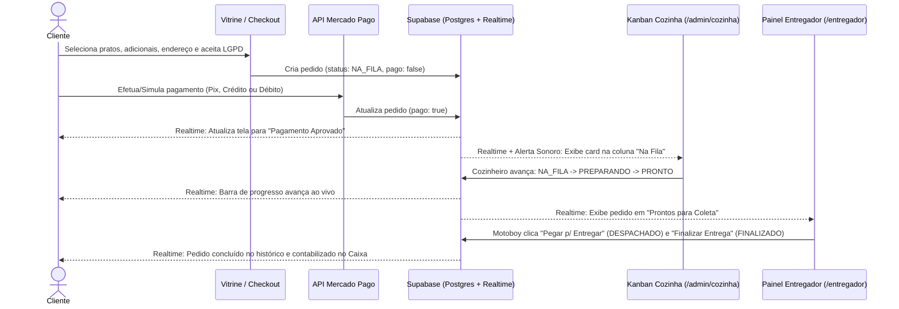
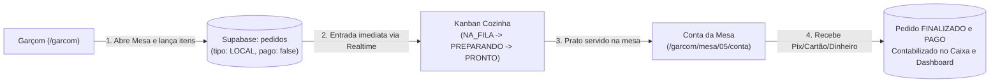

# 🌵 Raízes do Nordeste — Plataforma Integrada de Delivery, Salão e Gestão em Tempo Real (ERP)

> **Projeto Acadêmico / TCC — Análise e Desenvolvimento de Sistemas (ADS)**  
> **Autor:** Robson Carolino  
> **Aplicação em Produção (Vercel):** [https://restaurante-raizes-do-nordeste.vercel.app/](https://restaurante-raizes-do-nordeste.vercel.app/)  
> **Política de Privacidade e Conformidade LGPD:** [https://restaurante-raizes-do-nordeste.vercel.app/privacidade](https://restaurante-raizes-do-nordeste.vercel.app/privacidade)

---

## 📌 1. Visão Geral do Sistema

O **Raízes do Nordeste** é uma plataforma web *full-stack* completa que integra, em um único ecossistema sincronizado em **tempo real (WebSockets)**, todas as frentes operacionais de um restaurante contemporâneo:

1. **Autoatendimento e Delivery Online (`/`)**: Vitrine gastronômica interativa com busca, filtro por categorias, personalização de pratos (remoção de ingredientes e adição de acompanhamentos), gestão de múltiplos endereços, checkout transparente (**Pix**, **Cartão de Crédito** e **Cartão de Débito** via API do **Mercado Pago**) e rastreamento ao vivo do pedido.
2. **Atendimento Presencial de Salão — Painel do Garçom (`/garcom`)**: Interface *mobile-first* para abertura de mesas, lançamento de pedidos por rodada diretamente para a fila da cozinha e fechamento de conta no salão.
3. **Produção — Kanban da Cozinha (`/admin/cozinha`)**: Painel KDS (*Kitchen Display System*) com atualização automática via **Supabase Realtime** e alerta sonoro a cada novo pedido pago ou comandado no salão.
4. **Logística — Painel do Entregador (`/entregador`)**: Painel *mobile-first* para motoboys com fila de coleta, atalhos diretos para rota no **Google Maps (GPS)** e contato via **WhatsApp**, além de baixa de entrega em tempo real.
5. **Gestão Financeira e Administrativa (`/admin`)**: Controle de turnos de caixa (abertura, sangrias, suprimentos e conciliação de fechamento), Dashboard analítico de vendas, gestão de equipe com permissões granulares (**RBAC**) e **Importação Automática de Cardápio por Inteligência Artificial (Google Gemini)**.

---

## 🔑 2. Credenciais de Demonstração (Acesso Rápido para Avaliação)

Para facilitar a avaliação pelo professor e pela banca examinadora, o banco de dados em produção já conta com **1 usuário configurado para cada função operacional**. Todos utilizam a mesma senha padrão:

| Perfil / Papel | E-mail de Acesso | Senha | Portal de Login | Rota Principal | O que testar neste perfil |
| :--- | :--- | :--- | :--- | :--- | :--- |
| **Cliente** | `cliente.teste@raizes.com` | `Teste@123456` | [`/login`](https://restaurante-raizes-do-nordeste.vercel.app/login) | `/` | Montar sacola, escolher Delivery/Balcão, simular pagamento online e acompanhar barra de status em tempo real. |
| **Administrador** | `admin.teste@raizes.com` | `Teste@123456` | [`/admin/login`](https://restaurante-raizes-do-nordeste.vercel.app/admin/login) | `/admin/dashboard` | Acesso total: Dashboard, Caixa, Pedidos, Cardápio com IA, Equipe, Clientes e Configurações da Loja. |
| **Gerente / Caixa** | `gerente.teste@raizes.com` | `Teste@123456` | [`/admin/login`](https://restaurante-raizes-do-nordeste.vercel.app/admin/login) | `/admin/caixa` | Abrir/fechar turno de caixa, lançar sangrias/suprimentos e acompanhar chegada de pedidos ao vivo. |
| **Cozinha (KDS)** | `cozinha.teste@raizes.com` | `Teste@123456` | [`/admin/login`](https://restaurante-raizes-do-nordeste.vercel.app/admin/login) | `/admin/cozinha` | Receber pedidos com aviso sonoro e avançar cartões: `Na Fila` → `Preparando` → `Pronto`. |
| **Garçom (Salão)** | `garcom.teste@raizes.com` | `Teste@123456` | [`/admin/login`](https://restaurante-raizes-do-nordeste.vercel.app/admin/login) | `/garcom` | Abrir nova mesa (ex.: Mesa 05), adicionar pratos na comanda e fechar a conta da mesa. |
| **Entregador** | `entregador.teste@raizes.com` | `Teste@123456` | [`/admin/login`](https://restaurante-raizes-do-nordeste.vercel.app/admin/login) | `/entregador` | Visualizar pedidos prontos para coleta, abrir GPS/WhatsApp, iniciar rota (`Despachado`) e concluir entrega. |

> [!TIP]
> **Simulação de Pagamento sem Gasto Real:** Na tela do pedido (`/pedido/[id]`), o sistema opera integrado ao modo de avaliação/sandbox. Basta clicar no botão **"Simular Pagamento Aprovado (Teste)"** (no Pix) ou preencher dados fictícios no cartão para aprovar o pagamento instantaneamente e disparar o pedido em tempo real para a Cozinha e para o Caixa.

---

## 🏗️ 3. Arquitetura e Tecnologias Utilizadas

| Camada | Tecnologia | Finalidade no Projeto |
| :--- | :--- | :--- |
| **Framework Full-Stack** | **Next.js 16.3 (App Router)** | Renderização híbrida (Server Components + Client Components), Route Handlers e Server Actions. |
| **Linguagem** | **TypeScript 5** | Tipagem estática ponta a ponta em componentes, payloads de pedidos e integrações. |
| **Estilização & UI** | **Tailwind CSS v4 + shadcn/ui** | Design System responsivo (*mobile-first*), suporte a Tema Claro/Escuro (`next-themes`) e ícones `lucide-react`. |
| **Estado no Cliente** | **Zustand (`cartStore`)** | Gerenciamento da sacola de compras persistida no navegador com cálculo automático de adicionais. |
| **Banco de Dados & Auth** | **Supabase (PostgreSQL + GoTrue)** | Persistência relacional, autenticação JWT em cookies `HttpOnly` (`@supabase/ssr`) e **Row Level Security (RLS)**. |
| **Tempo Real** | **Supabase Realtime** | Sincronização instantânea via WebSockets (`postgres_changes`) entre Cliente, Caixa, Cozinha e Entregador. |
| **Pagamentos** | **Mercado Pago API** | Geração de QR Code Pix dinâmico, processamento de Cartão de Crédito/Débito e Webhook de confirmação. |
| **Inteligência Artificial** | **Google Gemini 2.5 Flash** | Leitura multimodal de fotos/PDFs de cardápios físicos para cadastro automatizado de pratos e complementos. |

---

## 🔄 4. Fluxos Operacionais do Sistema

### 4.1. Fluxo de Pedido Online (Delivery / Retirada no Balcão)



### 4.2. Fluxo de Atendimento Presencial no Salão (Garçom + Cozinha)



---

## 🗄️ 5. Estrutura de Pastas e Módulos

```text
Raizes-do-Nordeste/
├── documentacao/
│   ├── arquitetura_e_rotas.md      # Mapa detalhado de rotas e matriz de permissões RBAC
│   ├── schema_supabase.sql         # DDL completo das tabelas, constraints e relacionamentos
│   └── otimizacao_indices.sql      # Índices compostos B-Tree para otimização de consultas
├── src/
│   ├── app/
│   │   ├── (cliente)/              # Vitrine (/), Produto, Checkout, Pedido ao vivo, Perfil e LGPD (/privacidade)
│   │   ├── (admin-login)/          # Login corporativo com redirecionamento automático por cargo
│   │   ├── (admin)/                # Dashboard, Caixa, Pedidos, Cozinha, Produtos (+IA), Equipe e Clientes
│   │   ├── (garcom)/               # Painel de Mesas, Comanda e Fechamento de Conta
│   │   ├── (entregador)/           # Painel Logístico de Entregas (GPS + WhatsApp)
│   │   └── api/                    # Endpoints Mercado Pago (Pagamento + Webhook) e Cron Keep-Alive
│   ├── components/
│   │   ├── admin/                  # Componentes do ERP, Kanban, Caixa, Modais e Importador IA
│   │   ├── cliente/                # Vitrine, Sacola, Checkout, Status Realtime e CookieBanner LGPD
│   │   ├── entregador/             # Cards e controles de rota do entregador
│   │   └── ui/                     # Componentes base reutilizáveis (Button, Sheet)
│   ├── lib/
│   │   ├── supabase/               # Clientes Supabase (Browser, Server SSR e Service Role)
│   │   ├── admin.ts                # Verificação de sessão e RBAC com React.cache()
│   │   └── mercadopago.ts          # Integração com a API REST do Mercado Pago
│   └── store/
│       └── cartStore.ts            # Estado global da sacola de compras (Zustand)
└── vercel.json                     # Configuração de Cron Job na Vercel
```

---

## 🛡️ 6. Segurança, Performance e Adequação à LGPD (Lei nº 13.709/2018)

O projeto foi auditado e adaptado para atender aos requisitos técnicos de segurança da informação e à legislação brasileira de proteção de dados:

1. **Consentimento Explícito e Desmarcado por Padrão (Art. 7º, I e Art. 8º da LGPD):**
   - Todos os formulários que coletam ou atualizam dados pessoais (Cadastro de Conta em `/login`, Finalização de Pedido em `/checkout`, Atualização de Perfil e Endereços em `/perfil` e Cadastro de Colaboradores em `/admin/equipe`) possuem **checkboxes de consentimento desmarcados por padrão (`false`)**, registrando o aceite nos metadados do titular (`lgpd_consentimento` e `lgpd_consentimento_em`).
2. **Transparência e Gestão de Cookies (`CookieBanner`):**
   - Banner global presente em todas as páginas permitindo ao usuário escolher entre *"Aceitar e Continuar"* ou *"Apenas Essenciais"*, persistindo a decisão em `localStorage` (`raizes-lgpd-cookie-consent`).
3. **Política de Privacidade Real e Completa (`/privacidade`):**
   - Documenta de forma transparente todos os dados coletados, bases legais, tabela de cookies/`localStorage`, operadores terceiros (Supabase, Mercado Pago e Vercel), retenção e direitos do titular (Art. 18 da LGPD).
4. **Minimização de Dados Financeiros (PCI-Compliance):**
   - Dados sensíveis de cartão de crédito/débito (número do cartão, validade e CVV) **jamais são armazenados no banco de dados** do restaurante.
5. **Otimização de Performance Server-Side:**
   - Uso de `React.cache()` em `src/lib/admin.ts` para deduplicar validações de autenticação e perfil em Server Components, aliado a consultas paralelas com `Promise.all()` e índices compostos no PostgreSQL.

---

## 💻 7. Como Executar o Projeto Localmente

### Pré-requisitos
- **Node.js** 20+ instalado
- Conta e projeto ativo no **Supabase**

### Passo a Passo

1. **Clone o repositório:**
   ```bash
   git clone https://github.com/zHYPERSNIKEz/Raizes-do-Nordeste.git
   cd Raizes-do-Nordeste
   ```

2. **Instale as dependências:**
   ```bash
   npm install
   ```

3. **Configure as variáveis de ambiente:**
   Crie um arquivo `.env.local` na raiz do projeto com as seguintes chaves:
   ```env
   NEXT_PUBLIC_SUPABASE_URL=https://seu-projeto.supabase.co
   NEXT_PUBLIC_SUPABASE_ANON_KEY=sua_chave_anon_publica
   SUPABASE_SERVICE_ROLE_KEY=sua_chave_service_role_secreta

   # Opcional: Integração Mercado Pago e Importação de Cardápio via IA
   MERCADOPAGO_ACCESS_TOKEN=TEST-seu-access-token
   NEXT_PUBLIC_MERCADOPAGO_PUBLIC_KEY=TEST-sua-public-key
   GEMINI_API_KEY=sua_chave_google_gemini
   ```

4. **Estrutura do Banco de Dados:**
   No **SQL Editor** do Supabase, execute os scripts localizados em:
   - `documentacao/schema_supabase.sql`
   - `documentacao/otimizacao_indices.sql`

5. **Inicie o servidor de desenvolvimento:**
   ```bash
   npm run dev
   ```
   Acesse `http://localhost:3000` no navegador.
